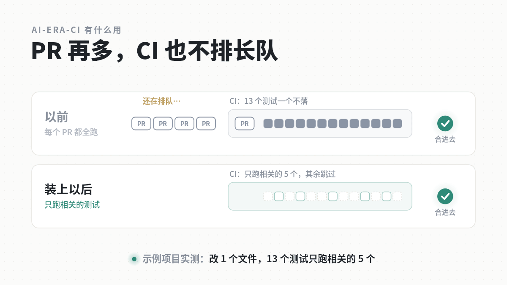

# ai-era-ci：把 CI 改成跟得上 AI 写代码的速度

AI 一天能开几十、上百个 PR。每个 PR 都把全部测试跑一遍，CI 就排长队、烧额度。

这是一份 **Agent Skill**：交给你项目里的 AI，它会把检查拆成四个时候；PR 多到排队时，再帮你「攒批」。全程边做边用大白话讲，最后给你一段面试 30 秒版。



| | 什么时候 | 查什么 | 要多快 |
|---|---|---|---|
| ① | 每次 commit 之前 | 格式、lint | 几秒，本地 |
| ② | 开 PR 时 | 只跑和改动相关的测试 | 限时 5 分钟（建议值） |
| ③ | 合进主分支后 | 全部测试，包括慢的 | 可以慢 |
| ④ | 上线后 | 特性开关先开给 5% 的用户（建议值） | 没问题再放大 |
| 攒批 | PR 多到排队时（可选） | 几个分支攒成一个 PR，只跑一趟重检查 | 一批一趟 |

**底线：只有全绿的版本才能发给用户。**

## 安装（选一种）

**Claude Code，在项目根目录执行：**

```bash
mkdir -p .claude/skills/ai-era-ci && curl -fsSL https://raw.githubusercontent.com/jiangan-code/ai-era-ci/main/SKILL.md -o .claude/skills/ai-era-ci/SKILL.md
```

想让所有项目都能用，就装到个人目录：

```bash
git clone https://github.com/jiangan-code/ai-era-ci ~/.claude/skills/ai-era-ci
```

**Cursor、Codex、ChatGPT 等其他 AI：** 打开 [SKILL.md](SKILL.md)，复制全文发给它。

装好以后，对 AI 说：

> 帮我把 CI 拆成 4 个时候

## 它会做什么


1. **先看你的项目：** 用什么语言、测试框架；有没有 CI；测试要跑多久。
2. **装好 ① 和 ②，然后亲手验证：**
   - 故意写乱格式再提交，看会不会被拦下；
   - 只改一个文件，看是不是只跑了相关测试。
3. **③、④ 和攒批先问你再装。** 攒批之前会先问你三个问题，判断你到底需不需要。
4. **最后交给你：**
   - 改了哪些文件；
   - 真实的验证数字；
   - 面试 30 秒版；
   - 一句能写进简历的话。

它不会替你 push，也不会改仓库设置。已有 CI 每个 PR 都全跑的，它会拆开；测试一个都不丢，只是挪到合适的时候跑。

**支持：**
- **Python：** pre-commit + ruff + pytest；
- **JS/TS：** husky + lint-staged，Vitest 或 Jest；
- **Go：** 只有做法说明，没有现成脚本；
- 以 GitHub Actions 为主，GitLab 也能照着做。

## 想先看效果

示例仓库 [ai-ci-demo](https://github.com/jiangan-code/ai-ci-demo) 是一个小网店项目，四个时候和攒批都已经装好了：
- `git checkout ep1`：四个时候；
- `git checkout ep2`：攒批。

## 已验证 / 没验证

**已验证：** skill 里的脚本和配置模板都在真实仓库里跑过。

| 模板 | 实测内容 |
|---|---|
| 选相关测试的脚本 | 只改一个文件：挑出相关测试；改了公共文件：全跑；只改 README：跳过 |
| 攒批脚本 | 格式不过的分支挡在批外；冲突的分支留给下一批；批次红了加一个修复分支变绿；上一批没合进去时，新批次被拦下 |
| Vitest / Jest 的只跑相关测试 | 实测通过 |
| 特性开关 | Python 和 TS 两版分桶结果一致 |
| 所有 workflow | 都过了 actionlint |

**没验证：**
- 在真实 GitHub 仓库里用 gh 自动开批次 PR；
- Go 的做法。

## License

MIT
